<div align="center">

# 🎬 IMDb Movie Rating Analytics

**What makes a movie great, and can a model tell before the reviews come in?**
An end-to-end analysis in R, from raw IMDb tables to Decision Tree and Random Forest models that rank the **best, worst, highest-rated, lowest-rated, and most-watched** movies.


[](https://www.kaggle.com/datasets/ahmedosamamath/imdb-dataset)


[The answers](#-the-answers) · [Results](#-results) · [Insights](#-key-insights) · [Pipeline](#-pipeline) · [Explore the data](#-exploratory-analysis) · [Quick start](#-quick-start)

</div>

---

## ✨ At a Glance

| 🎞 Movies analysed | ⭐ Mean rating | 🎯 Random Forest accuracy | 👀 Most votes on one movie |
|:---:|:---:|:---:|:---:|
| **13,426** | **6.13** | **53.6%** | **3.25M** |

> **The short version:** ratings are only *partly* predictable from metadata. **Genre is the clearest signal** (about 61% of Documentaries are High-rated, about 70% of Horror films are Low-rated), followed by popularity (votes), release era and runtime. The adult flag barely matters. For a trustworthy "best" and "worst", rank by a **vote-weighted score**, not by raw rating.

---

## 🎯 Project Goal

A rating of 9.0 from five voters and a rating of 8.5 from two million voters are not the same thing. This project answers three questions:

1. **Which movies** are the best, worst, highest-rated, lowest-rated and most-watched?
2. **Which features** (genre, year, runtime, popularity, adult flag) go with a higher or lower rating?
3. **How well can ML** predict a movie's rating class and score on movies it has never seen?

---

## 🏆 The Answers

| Question | Method | Answer |
|---|---|---|
| 🥇 **Best movie** | Highest Bayesian weighted score | **The Shawshank Redemption** (1994), score 9.30 |
| 💀 **Worst movie** | Lowest Bayesian weighted score | **Kadiköy Bogasi** (2025), score 2.26 (rating 1.0 from 7,061 votes) |
| 👀 **Most-watched movie** | Highest vote count (proxy for views) | **The Shawshank Redemption**, 3,251,848 votes |
| 🤖 **Highest-rated (ML)** | Random Forest, predicted rating | **The Untold Intifada** (2026), predicted 7.21 |
| 🤖 **Lowest-rated (ML)** | Random Forest, predicted rating | **Hacksaw** (2020), predicted 4.77 |

> [!NOTE]
> IMDb has no view-count field, so **number of votes** is the proxy for "most watched". The ML lists need careful reading; see [ML-based rankings](#-ml-based-movie-rankings).

---

## 🗂 Dataset

- **Source:** [IMDb Dataset on Kaggle](https://www.kaggle.com/datasets/ahmedosamamath/imdb-dataset)
- **Files used:** `title_basics.csv` and `title_ratings.csv`, inner-joined on `tconst`, keeping `titleType == "movie"`

| Stage | Movies |
|---|---:|
| Rated movies after the join | 15,863 |
| After dropping rows with missing values | 14,198 |
| After removing runtime outliers | **13,426** |
| Train (75%) / test (25%) | 10,071 / 3,355 |

The target for classification is `Rating_Class`. The classes are **not** balanced, so the baseline to beat is **45.1%** (always guessing "Medium").

| Class | Rule | Movies | Share |
|---|---|---:|---:|
| 🟢 High | rating ≥ 7.0 | 3,522 | 26.2% |
| 🟡 Medium | 5.5 ≤ rating < 7.0 | 6,059 | 45.1% |
| 🔴 Low | rating < 5.5 | 3,845 | 28.6% |

<details>
<summary><b>📖 Data dictionary (click to expand)</b></summary>

<br>

| Column | Type | Description |
|---|---|---|
| `tconst` | ID | Unique IMDb title ID (join key, kept as `Title_ID`) |
| `titleType` | Categorical | Filtered to `movie`, so constant afterwards |
| `primaryTitle` | Text | Movie title |
| `isAdult` | Binary | Adult-content flag (176 of 13,426 movies) |
| `startYear` | Numeric | Release year, 1907–2026 |
| `runtimeMinutes` | Numeric | Runtime in minutes (47–138 after outlier removal) |
| `genres` | Categorical | Comma-separated list; the **first** genre is used as the primary genre |
| `averageRating` | Numeric | Mean IMDb user rating, 1–10 (**modelling target**) |
| `numVotes` | Numeric | Number of votes (right-skewed, up to 3.25M) |

`originalTitle` and `endYear` are dropped; they are not used in the analysis.

</details>

<details>
<summary><b>🔢 Label-encoding reference (needed to read the tree and heatmaps)</b></summary>

<br>

| Code | Genre group | | Code | Rating class |
|:---:|---|---|:---:|---|
| 1 | Action | | 1 | High_Rated |
| 2 | Adult | | 2 | Low_Rated |
| 3 | Adventure | | 3 | Medium_Rated |
| 4 | Biography | | | |
| 5 | Comedy | | | |
| 6 | Crime | | | |
| 7 | Documentary | | | |
| 8 | Drama | | | |
| 9 | Horror | | | |
| 10 | Other (genres outside the top 10) | | | |
| 11 | Thriller | | | |

Codes are assigned alphabetically, which is why class **1 = High**, **2 = Low**, **3 = Medium** in every confusion matrix.

</details>

---

## 🔧 Pipeline


| Step | What happens |
|---|---|
| **Cleaning** | Joined the two tables, kept movies only, read `NAN` / `\N` / empty strings as `NA`, dropped incomplete rows and duplicate IDs |
| **Weighted score** | IMDb-style Bayesian rating (formula below) so that low-vote movies don't win or lose by chance |
| **Outliers** | IQR rule (1.5×) on runtime only, keeping **46.5–138.5 min** (removes 772 movies). Vote outliers are **kept on purpose**, since they are the most-watched movies |
| **Encoding** | `Genre_Group`, `Is_Adult` and `Rating_Class` label-encoded |
| **Scaling** | Min-max scaling of year and runtime, `log10(votes + 1)`. Tree-based models are unaffected by monotonic transforms, so these don't change the tree results |
| **Feature selection** | Inspected the correlation matrix and checked for variance < 0.001 (no feature was dropped). `Rating_Scaled` and `Weighted_Score_Scaled` are **removed before classification** to prevent target leakage |
| **Split** | 75% train / 25% test, stratified on the target, fixed seed (`123`) |
| **Models** | Decision Tree (`rpart`, `cp = 0.005`) and Random Forest (`randomForest`, 200 trees) for classification; `anova` tree and Random Forest (100 trees) for regression |
| **Metrics** | Accuracy and macro precision / recall / F1 for classification; RMSE, MAE and R² for regression |

**Weighted score:**

$$
WR = \frac{v}{v+m}\,R + \frac{m}{v+m}\,C
$$

where `R` is the movie's rating, `v` its votes, `m` the **90th percentile of votes (≈ 2,296)** and `C` the **mean rating across all movies (≈ 6.13)**.

---

## 📊 Results

Evaluated on **3,355 unseen movies** (the 25% hold-out set) for classification.

| Model | Accuracy | Precision | Recall | F1 |
|---|:---:|:---:|:---:|:---:|
| 🌲 **Random Forest** | **0.536** | **0.534** | **0.509** | **0.515** |
| 🌳 Decision Tree | 0.520 | 0.521 | 0.485 | 0.490 |
| *Baseline: always "Medium"* | *0.451* | – | – | – |

*Precision, recall and F1 are macro-averaged over the three classes.*

The Random Forest wins on every metric. In plain terms: it classified **1,798 of 3,355** movies correctly (the Decision Tree got 1,744; always guessing "Medium" would get 1,514). It finds the dominant class easiest and struggles most with Low-rated movies:

| Class | Random Forest recall |
|---|:---:|
| 🟡 Medium | 66.8% |
| 🟢 High | 47.8% |
| 🔴 Low | 38.0% |

> A 3-class problem where the best guess is right 45% of the time is a hard one. An 8-point gain over the baseline is a real but modest signal, which is what you'd expect when the model can't see cast, director or plot.

| 🌲 Random Forest | 🌳 Decision Tree |
|:---:|:---:|
| 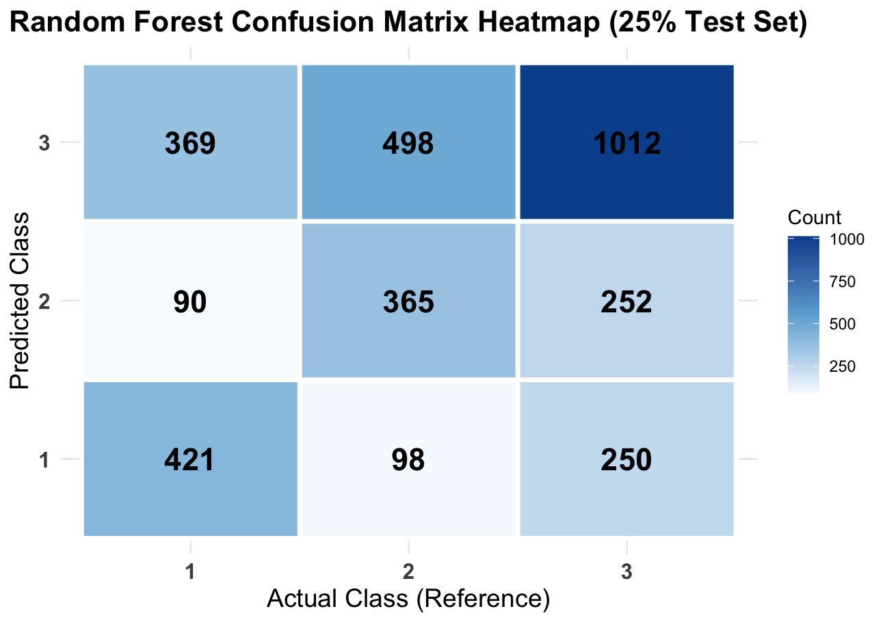 | 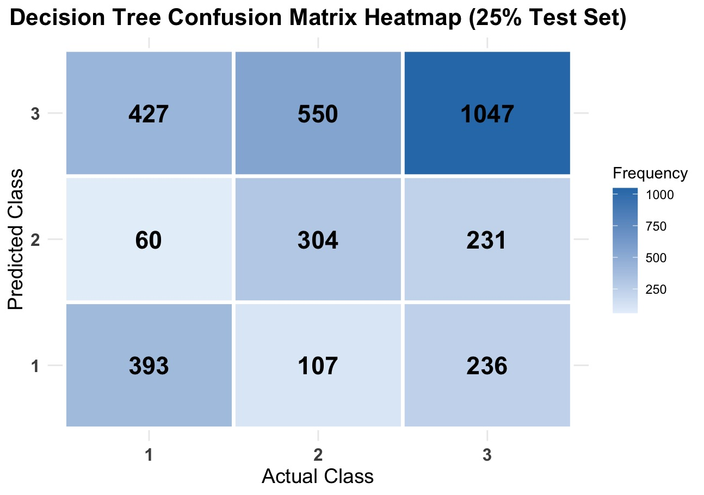 |

<sub>Class codes: 1 = High, 2 = Low, 3 = Medium.</sub>

### 🌲 The forest is stable

The out-of-bag error settles at about **0.46** after roughly 100 trees, and it matches the test-set error (1 − 0.536 = 0.464). That is a good sign the model isn't memorising the training data. The error is lowest for the Medium class (about 0.34) and highest for Low (about 0.59), mirroring the recall table above.

<div align="center">

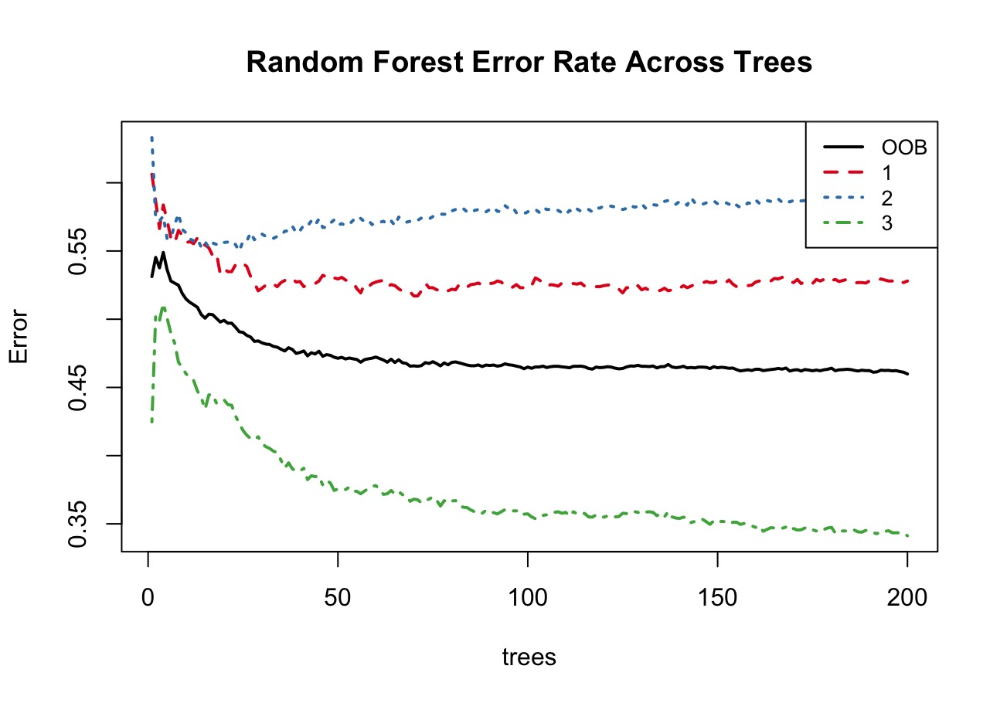

</div>

### 🎚 What the forest relies on

<div align="center">

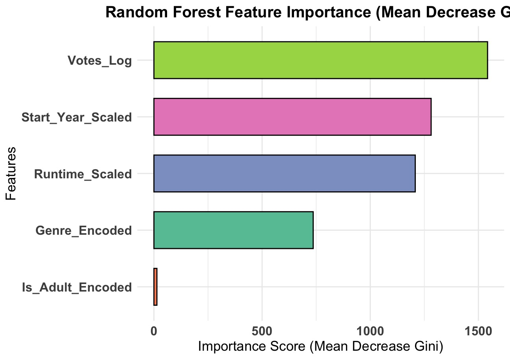

<sub>**Feature importance (Mean Decrease Gini):** votes › release year › runtime › genre › adult flag (negligible)</sub>

</div>

> Gini importance favours continuous features, so genre looks less important here than it really is. The decision tree below uses genre for its first three splits.

### 📈 Regression: predicting the weighted score

Models predict `Weighted_Score` from year, runtime, adult flag, votes and genre (10,650 train / 3,548 test).

| Model | RMSE | MAE | R² |
|---|:---:|:---:|:---:|
| 🌲 **Random Forest** (100 trees) | **0.285** | 0.125 | **0.199** |
| 🌳 Decision Tree (`anova`) | 0.291 | 0.124 | 0.165 |

<div align="center">

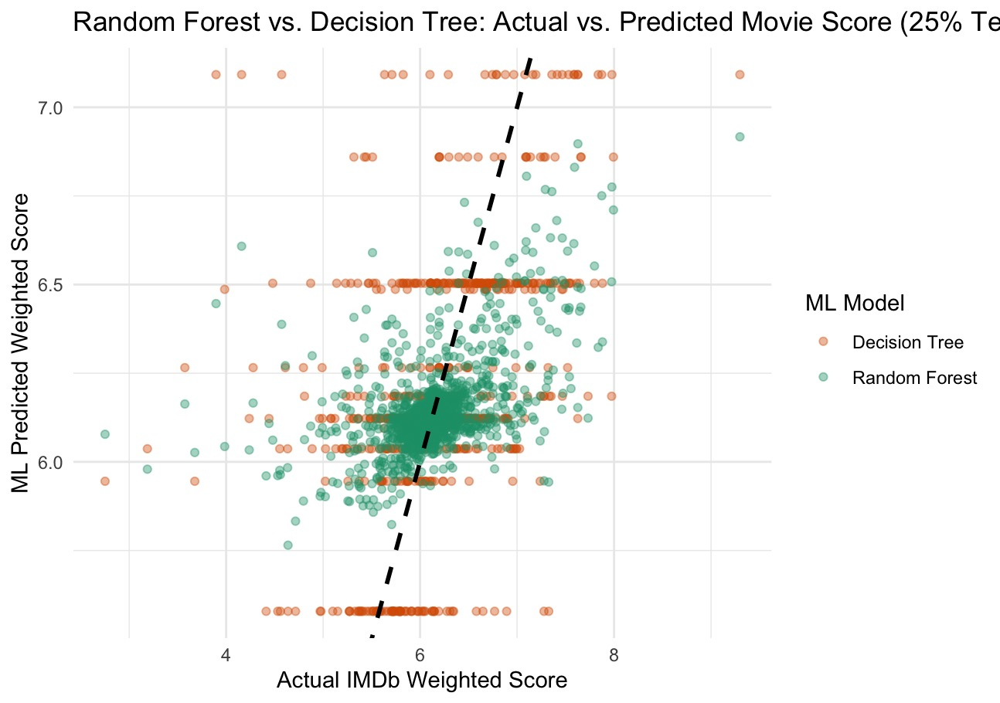

<sub>The Decision Tree predicts in flat bands (piecewise-constant). The Random Forest follows the diagonal more closely but compresses the extremes.</sub>

</div>

---

## 🔎 ML-based Movie Rankings

Both regression models score **every** movie, and the top five are listed (ties broken by votes).

<details open>
<summary><b>🥇 Best and 💀 worst movie (predicted weighted score)</b></summary>

<br>

| # | Best (Random Forest) | Pred. | Actual | | Worst (Random Forest) | Pred. | Actual |
|:---:|---|:---:|:---:|---|---|:---:|:---:|
| 1 | Django Unchained | 7.04 | 8.50 | | Jeepers Creepers: Reborn | 5.67 | 3.00 |
| 2 | Harakiri | 6.99 | 8.54 | | The Strangers: Chapter 3 | 5.74 | 4.60 |
| 3 | There Will Be Blood | 6.96 | 8.19 | | Popeye the Slayer Man | 5.76 | 4.64 |
| 4 | The Hobbit: An Unexpected Journey | 6.96 | 7.80 | | Kadiköy Bogasi | 5.78 | 2.26 |
| 5 | Scent of a Woman | 6.93 | 7.99 | | Helloween | 5.80 | 4.77 |

</details>

<details open>
<summary><b>📈 Highest-rated and 📉 lowest-rated movie (predicted rating)</b></summary>

<br>

| # | Highest (Random Forest) | Pred. | Actual | Votes | | Lowest (Random Forest) | Pred. | Actual | Votes |
|:---:|---|:---:|:---:|:---:|---|---|:---:|:---:|:---:|
| 1 | The Untold Intifada | 7.21 | 8.8 | 7 | | Hacksaw | 4.77 | 1.9 | 319 |
| 2 | Michael Jackson: Becoming the King of Pop | 7.19 | 9.0 | 6 | | Anaconda: Blood Coil | 4.79 | 2.3 | 221 |
| 3 | Broken Ends | 7.12 | 10.0 | 5 | | In a Stranger's House | 4.82 | 4.5 | 494 |
| 4 | Palliative Care Unit | 7.11 | 8.8 | 14 | | Norton Creek Massacre | 4.83 | 2.2 | 1,107 |
| 5 | Touching the Sky VR | 7.10 | 8.2 | 6 | | The Tombs | 4.83 | 3.2 | 351 |

</details>

<details>
<summary><b>🏅 Ground truth: actual top and bottom by weighted score</b></summary>

<br>

| # | Best (actual) | Score | | Worst (actual) | Score |
|:---:|---|:---:|---|---|:---:|
| 1 | The Shawshank Redemption | 9.30 | | Kadiköy Bogasi | 2.26 |
| 2 | Harakiri | 8.54 | | Humshakals | 2.65 |
| 3 | Django Unchained | 8.50 | | The Beast of Yucca Flats | 2.75 |
| 4 | Earthlings | 8.35 | | Jurassic Shark | 2.90 |
| 5 | Resurrection | 8.33 | | Jeepers Creepers: Reborn | 3.00 |

</details>

<details>
<summary><b>👀 Most-watched movies (by votes)</b></summary>

<br>

| # | Movie | Year | Genre | Rating | Votes |
|:---:|---|:---:|---|:---:|---:|
| 1 | The Shawshank Redemption | 1994 | Drama | 9.3 | 3,251,848 |
| 2 | Django Unchained | 2012 | Drama | 8.5 | 1,919,922 |
| 3 | Star Wars: Episode VI – Return of the Jedi | 1983 | Action | 8.3 | 1,226,610 |
| 4 | Reservoir Dogs | 1992 | Crime | 8.2 | 1,184,386 |
| 5 | The Hobbit: An Unexpected Journey | 2012 | Adventure | 7.8 | 939,074 |

</details>

> [!WARNING]
> **How to read the ML lists.** The models see only year, runtime, genre, adult flag and votes. They can't judge a film's quality and explain about 20% of the variance in the weighted score, so they rank movies by what their *profile* suggests.
> - The "highest-rated" list is filled with 2025–2026 titles that have only 5 to 14 votes. The forest learned that low-vote recent titles tend to have extreme ratings.
> - For a trustworthy "best" and "worst", use the **ground-truth table** above.

---

## 🌳 What the Decision Tree Learned

The tree is the easiest model to explain: its first three questions are all about **genre**, and only then does it use release year, runtime and votes.

<div align="center">

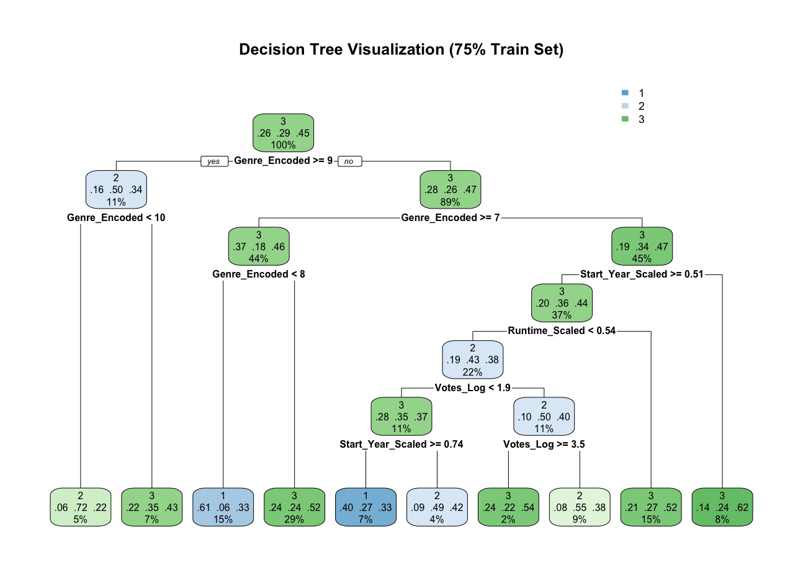

</div>

| Movie segment | Share of movies | Outcome |
|---|:---:|---|
| **Documentary** | 15% | 🟢 **61% High-rated** (only 6% Low) |
| **Horror** | 5% | 🔴 **72% Low-rated** |
| **Drama** | 29% | 🟡 52% Medium (24% High, 24% Low) |
| **Thriller or "Other"** genres | 7% | 🟡 43% Medium, 35% Low |
| Action / Adult / Adventure / Biography / Comedy / Crime, released **before 1968** | 8% | 🟡 62% Medium |
| Same genres, 1968+, runtime **≥ 97 min** | 15% | 🟡 52% Medium |
| Same genres, 1968+, runtime < 97 min, **fewer than ~88 votes**, released **1996+** | 7% | 🟢 40% High (a plurality, not a majority) |
| Same, but released **1968–1995** | 4% | 🔴 49% Low |
| Same genres, 1968+, runtime < 97 min, **~88 to 3,500 votes** | 9% | 🔴 55% Low |
| Same, but **more than ~3,500 votes** | 2% | 🟡 54% Medium |

<sub>Thresholds were converted from the scaled values the tree actually splits on (for example `Start_Year_Scaled ≥ 0.51` is a release year of about 1968). Shares are of the training set and are rounded.</sub>

---

## 💡 Key Insights

### 1. Genre is the strongest lever

| Primary genre | Movies | Mean rating | High-rated | Low-rated |
|---|:---:|:---:|:---:|:---:|
| 🟢 **Documentary** | 1,976 | **7.15** | **61%** | 6% |
| 🟢 Biography | 397 | 6.91 | 54% | 11% |
| Drama | 3,887 | 6.16 | 24% | 23% |
| Comedy | 2,868 | 5.82 | 17% | 36% |
| Action | 1,332 | 5.62 | 14% | 42% |
| Thriller | 219 | 5.56 | 15% | 49% |
| 🔴 **Horror** | 597 | **4.77** | 7% | **71%** |

### 2. Linear relationships are weak

Correlation of each numeric feature with rating:

| Feature | Correlation with rating |
|---|:---:|
| `Runtime` | +0.08 |
| `Votes` (log scale) | −0.07 |
| `Start_Year` | +0.06 |
| `Is_Adult` | −0.04 |

All of them are below 0.08 in absolute value, so single-variable linear trends explain very little. The signal is in **genre** and in **non-linear** patterns, which is why tree-based models beat a straight-line view of the data.

### 3. Popularity has a U-shaped link to rating

| Votes | Movies | Mean rating | High-rated | Low-rated |
|---|:---:|:---:|:---:|:---:|
| ≤ 50 | 5,430 | 6.35 | 35% | 25% |
| 51–100 | 1,832 | 6.13 | 27% | 28% |
| 101–1,000 | 4,089 | 5.71 | 14% | 36% |
| 1,000–10,000 | 1,538 | 6.06 | 23% | 27% |
| **> 10,000** | 537 | **6.45** | 34% | **15%** |

Very-low-vote movies have **noisy** ratings (many extreme highs *and* lows), while the most-voted movies rarely score low. This is why `Votes_Log` is the top feature in the forest, and why a weighted score is needed. Note that **54% of all movies have 100 votes or fewer**.

### 4. Longer films and recent films rate slightly higher

| Runtime | Mean rating | High-rated |
|---|:---:|:---:|
| ≤ 80 min | 6.17 | 30% |
| 81–100 min | 5.95 | 23% |
| 101–120 min | 6.24 | 27% |
| **121–138 min** | **6.46** | **36%** |

Average rating sits at about 5.9 to 6.1 for movies released before 2000 and about 6.2 from 2000 onward. The effect is small.

### 5. The adult flag is a weak, rare signal

Only **176 movies (1.3%)** are flagged adult. They average **5.6** versus **6.1**, and only 9.7% are High-rated versus 26.5%. With so few cases, the flag has almost no importance in the models.

---

## 🚀 Practical Takeaways

> These follow from the patterns above. They are hypotheses to test, since correlation does not prove cause.

| Priority | Takeaway | Why |
|:---:|---|---|
| 🥇 | **Rank with a vote-weighted score, never raw rating** | Two movies have a perfect 10.0 from only 5 and 8 votes; the weighted score puts *The Shawshank Redemption* on top instead |
| 🥈 | **Treat ratings with few votes as provisional** | 54% of movies have ≤ 100 votes, and low-vote movies show far more extreme ratings |
| 🥉 | **Compare a movie with its own genre, not the whole catalogue** | The average Documentary scores 7.15 and the average Horror film 4.77, so the same number means different things |
| 4 | **Don't expect metadata alone to judge quality** | The best model gets 53.6% against a 45.1% baseline and R² ≈ 0.20; adding cast, crew and budget is the logical next step |
| 5 | **Use ML rankings as profile-based priors, not verdicts** | The ML "highest-rated" list is dominated by tiny-vote titles |

---

## 🔍 Exploratory Analysis

<details open>
<summary><b>Univariate analysis: distributions and outliers</b></summary>

<br>

| Ratings | Genres |
|:---:|:---:|
| 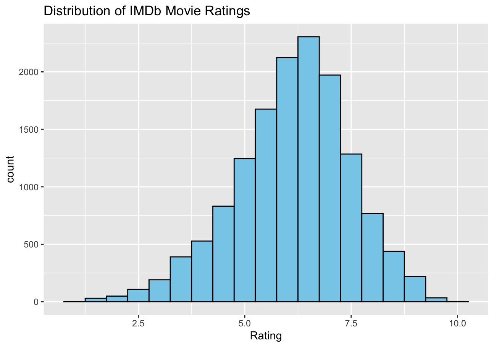 | 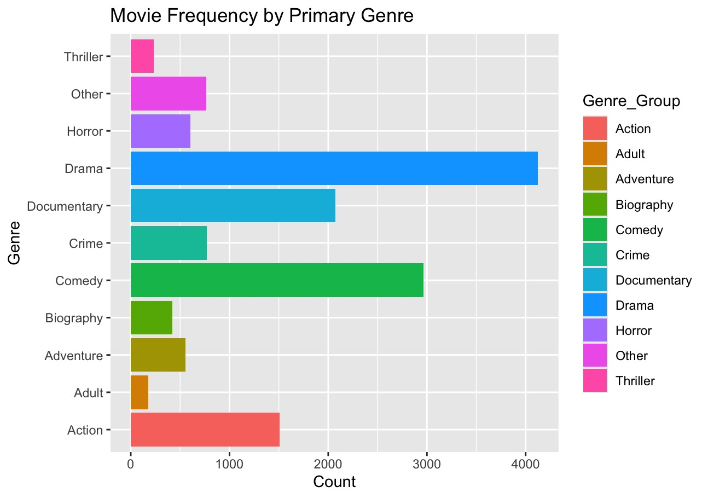 |
| *Roughly bell-shaped (mean 6.13) with a longer tail toward low scores* | *Drama (4,126) and Comedy (2,967) dominate* |

| Runtime | Outlier check |
|:---:|:---:|
| 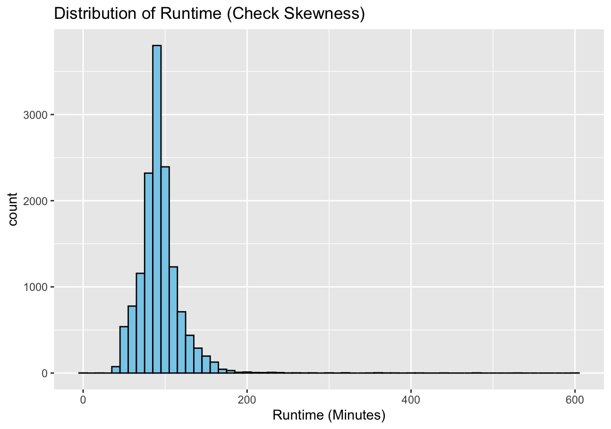 | 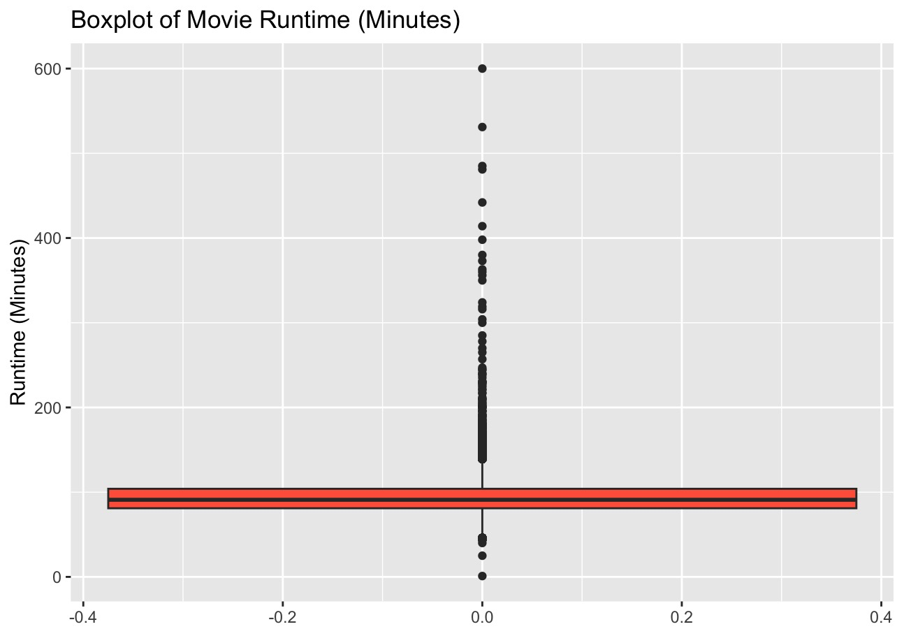 |
| *Peaks near 90 to 100 minutes with a long right tail* | *Runtimes reach 600 minutes, which motivates the IQR filter* |

<div align="center">

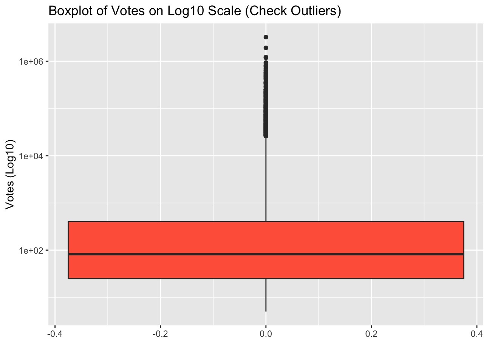

<sub>**Votes** are extremely right-skewed even on a log scale (median 82, max 3.25M)</sub>

</div>

</details>

<details open>
<summary><b>Bivariate analysis: relationships with rating and votes</b></summary>

<br>

| Runtime vs rating | Runtime vs votes |
|:---:|:---:|
| 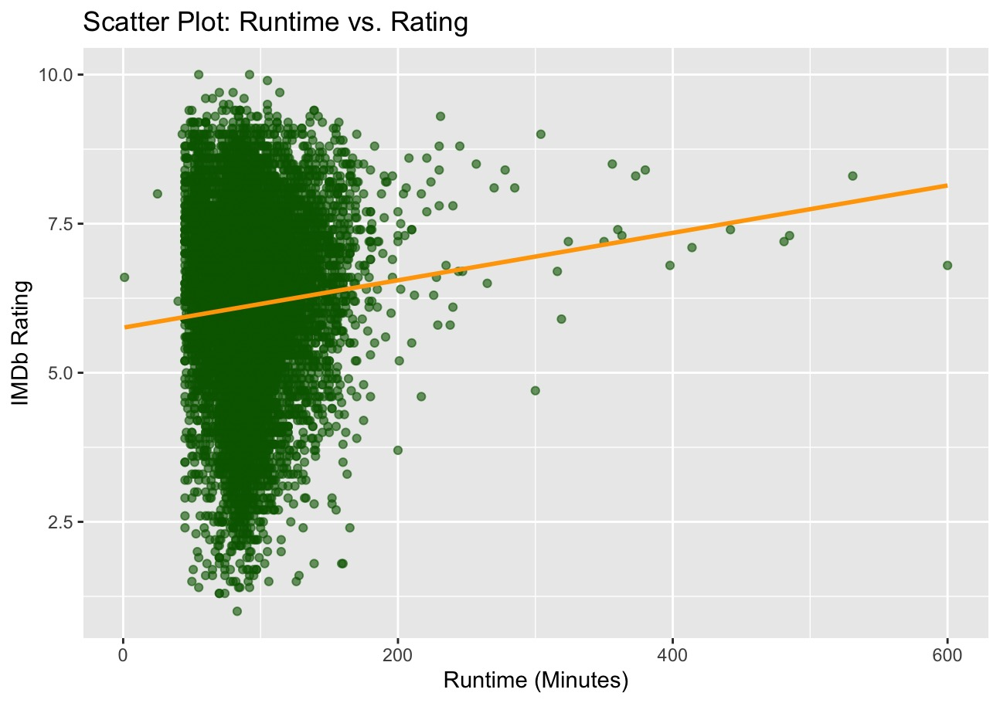 | 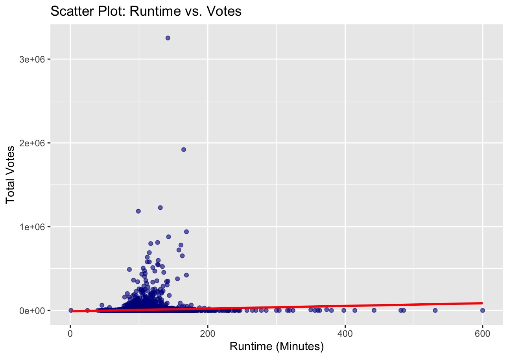 |
| *Slight upward trend, driven by a few very long films* | *The most-voted films cluster at about 100 to 170 minutes* |

| Year vs rating | Adult flag |
|:---:|:---:|
| 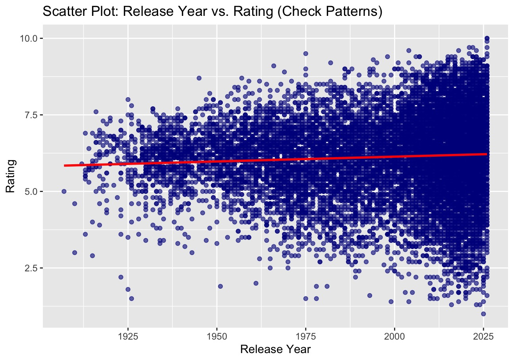 | 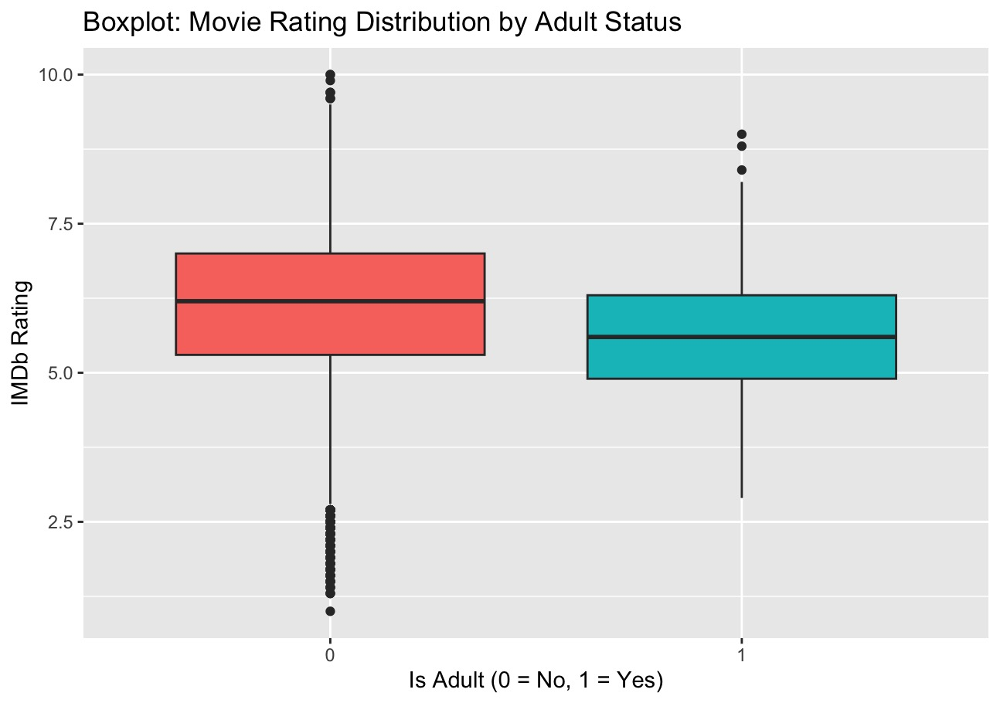 |
| *A slight upward drift, with a wider spread for recent releases* | *Lower median rating (about 5.6 vs 6.2)* |

<div align="center">

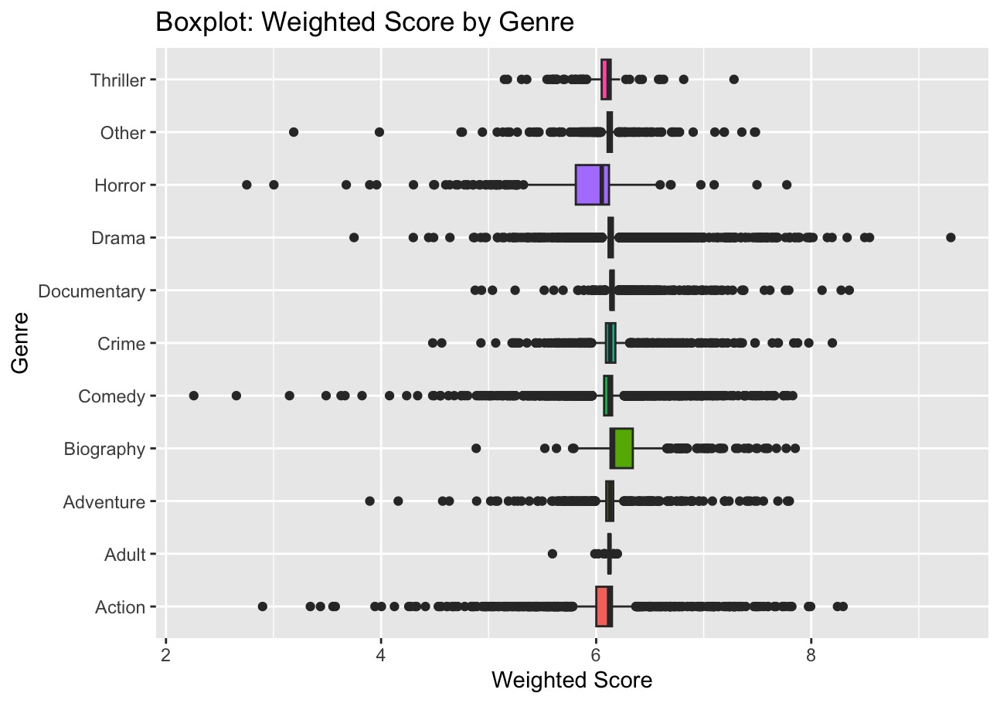

<sub>**Weighted score by genre:** Biography scores highest, Horror lowest with the widest spread. Most genres sit near 6.1 because the weighted score pulls low-vote titles toward the mean</sub>

</div>

</details>

---

## ⚠️ Limitations & Next Steps

Worth knowing before trusting the numbers:

- **Weak signal.** Metadata alone gives about 54% accuracy on three classes and R² ≈ 0.20. Cast, directors, budget and plot would help.
- **Votes partly determine the score.** The weighted score is built from rating *and* votes, and votes are also a model feature. Votes also reflect popularity, which is only known after release.
- **The rankings are in-sample.** The regression models score *every* movie, including the ones they were trained on, so the top-5 lists are not out-of-sample predictions. The test-set metrics above are the honest measure of accuracy.
- **Preprocessing was fitted on the full dataset before splitting** (outlier bounds, min-max scaling, the weighted-score constants `m` and `C`). The leakage is likely small, but a stricter setup would fit these on the training set only.
- **Label-encoded genre is ordered alphabetically.** That is harmless for trees, but the splits read as code ranges (see the [encoding reference](#-dataset)) and it would matter for linear models.
- **Only a sample of IMDb is covered.** Titles must appear in both input files to be joined, and 54% of the joined movies have ≤ 100 votes, so many ratings are noisy.
- **Primary genre only.** Multi-genre information is reduced to the first listed genre.
- **No hyperparameter tuning or cross-validation.** Both models use near-default settings and a single train/test split.

**Ideas for next steps:** add cast and crew features from `title_principals` and `title_crew`, multi-hot encode all genres, k-fold cross-validation, gradient boosting (XGBoost / LightGBM), a minimum-votes filter for the ML rankings, and a small Shiny dashboard.

---

## ⚡ Quick Start

**1. Clone the repo**

```bash
git clone https://github.com/<your-username>/<your-repo>.git
cd <your-repo>
```

**2. Get the data.** Download `title_basics.csv` and `title_ratings.csv` from the [Kaggle dataset](https://www.kaggle.com/datasets/ahmedosamamath/imdb-dataset), then do one of the following:

- **Google Drive (default):** set `basics_file_id` and `ratings_file_id` at the top of the script to your shared Drive file IDs.
- **Local files:** replace `basics_url` and `ratings_url` with your local paths, for example `"data/title_basics.csv"`.

**3. Install the packages**

```r
install.packages(c(
  "dplyr", "ggplot2", "GGally", "janitor", "caret",
  "rpart", "rpart.plot", "randomForest", "stringr"
))
```

**4. Run the analysis in R**

```r
source("imdb_movie_analysis.R", echo = TRUE)
```

In RStudio you can also run the script section by section to see each plot as it's produced.

> [!TIP]
> Run the `get_mode()` helper at the top first; the descriptive-statistics section needs it.

<details>
<summary><b>⚙️ Key parameters</b></summary>

<br>

These values are set directly in the script:

| Setting | Value | Purpose |
|---|:---:|---|
| `set.seed()` | `123` | Reproducible splits and forests |
| Train / test split | `0.75 / 0.25` | `createDataPartition(p = 0.75)` |
| `m_vote` | 90th percentile of votes | Weight of the prior in the Bayesian score |
| Outlier rule | IQR × `1.5` | Applied to runtime only |
| Rating classes | `< 5.5`, `5.5 – 7.0`, `≥ 7.0` | Low / Medium / High |
| Decision tree `cp` | `0.005` | Complexity pruning for the classifier |
| Random Forest `ntree` | `200` (classifier), `100` (regression) | Number of trees |

</details>

---

## 🧰 Tech Stack

| Purpose | Packages |
|---|---|
| Data wrangling | `dplyr`, `stringr`, `janitor` |
| Visualisation | `ggplot2`, `GGally`, `rpart.plot` |
| Modelling | `rpart`, `randomForest`, `caret` |
| Evaluation | `caret` (`confusionMatrix`) |

---

## 📁 Repository Structure

```
.
├── imdb_movie_analysis.R         # Full pipeline: load → EDA → model → evaluate → rank
├── images/                       # Plots referenced in this README
│   ├── Rplot.jpeg
│   ├── Rplot01.jpeg
│   ├── …
│   └── Rplot15.jpeg
└── README.md
```

---

<div align="center">

**Data:** [IMDb](https://www.imdb.com/) via [Kaggle](https://www.kaggle.com/datasets/ahmedosamamath/imdb-dataset) · IMDb data is provided for personal and non-commercial use.

**If you found this useful, consider giving the repo a ⭐**

</div>
